This was originally going to be a FPGA board which is why my reel says that but I decided to switch to a microcontroller. I am following a mix of tutorials on this one to make sure it actually works.

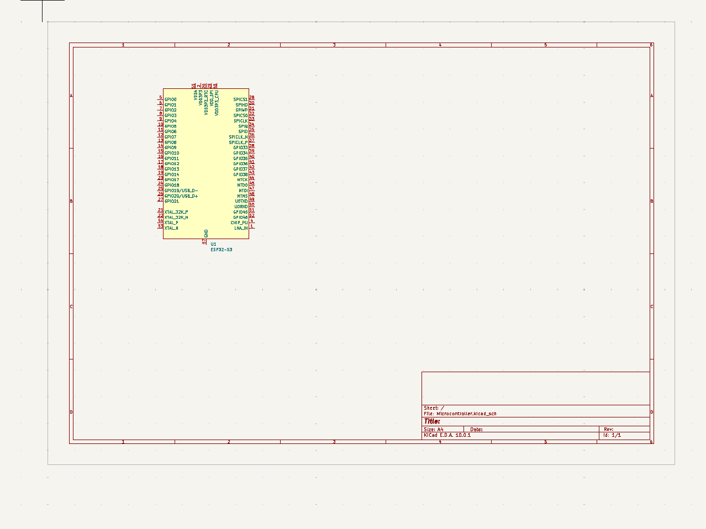
Ok so far, I started the PCB schematic. i settled on the ESP32-S3 because it's somewhat affordable and it's fast.
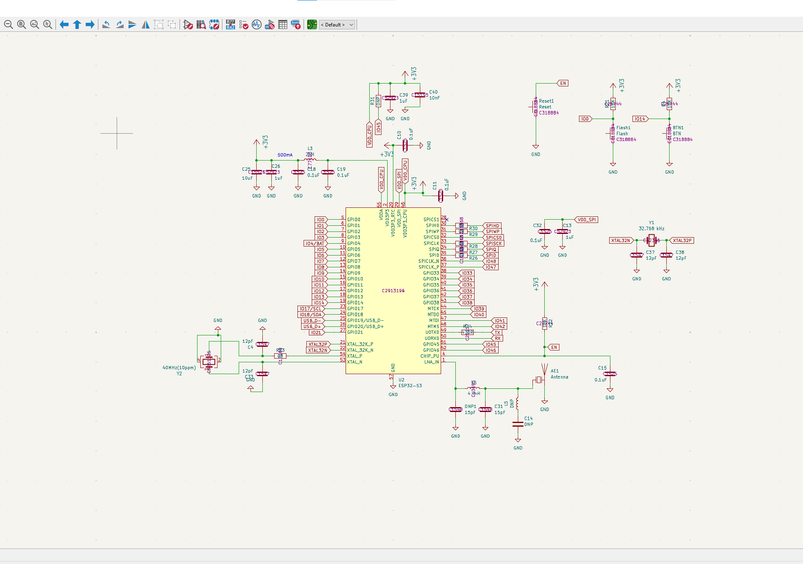
I added all the stuff that the ESP32 needs to work. To keep everything organized I need to put the jlcpcb/ LCSC part numbers in the schematic part number so I spent a while doing that stuff.
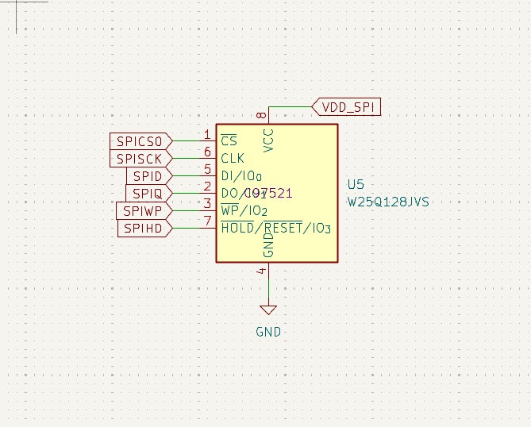
I added some extra memory, so it would be a little bit better than any other micro controller.
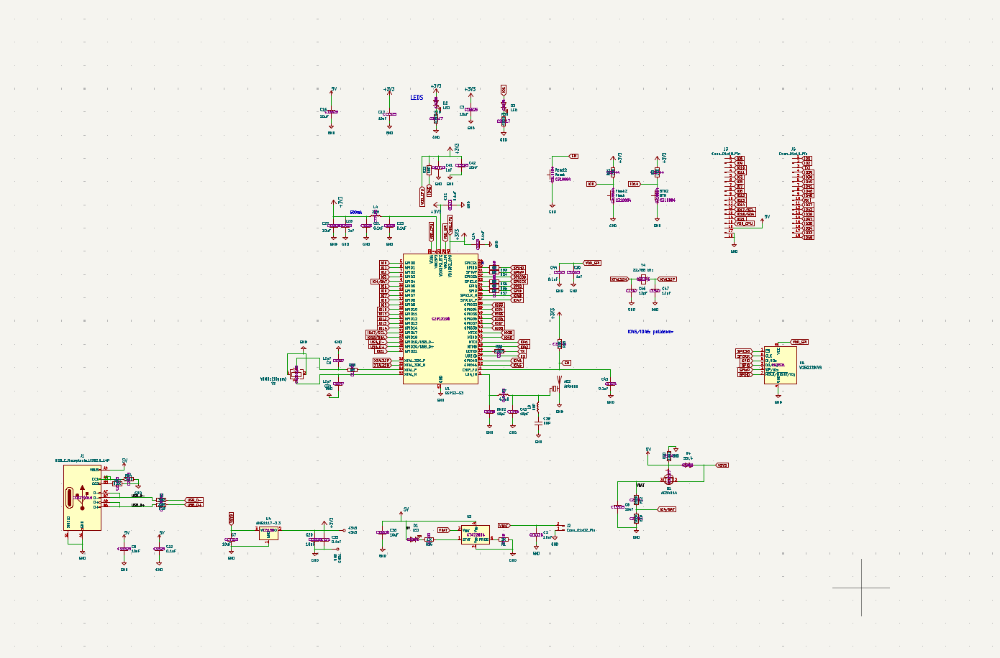
Here's the full schematic so far I've been following the mix of tutorials the tutorials taught me how to add a batter charger and usb-c port so that's nice.
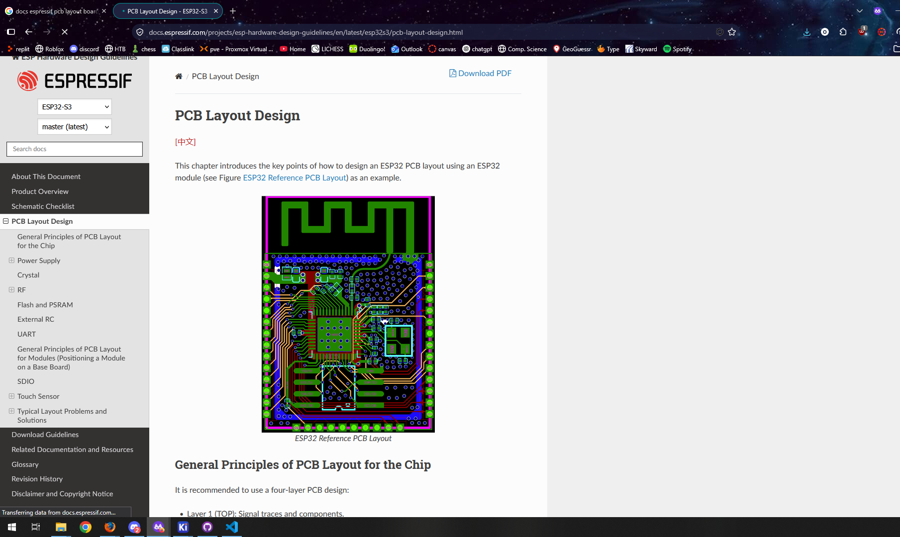
ESP32-s3 is also well documentated so I shouldn't have as much trouble making this PCB layout, which is nice (I always have trouble with routing).
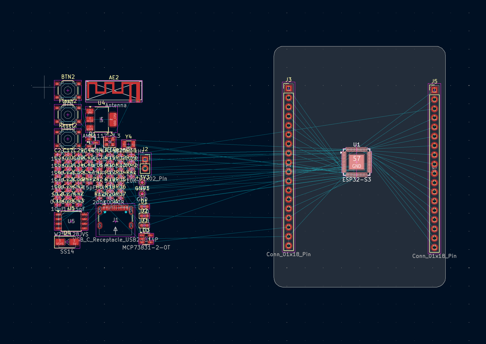
I started on the actual pcb part so let me lock in and finish the rest.
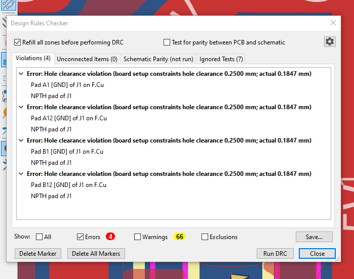
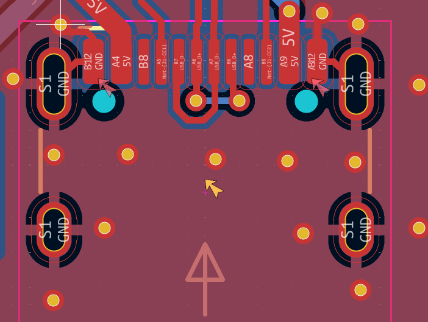
I think these errors are okay to skip as according to my research so yeah, the overall microcontroller looks fine and good to submit.
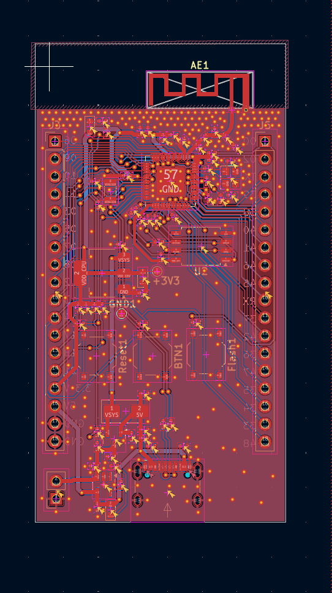
I think all I need to add is some fun silkscreen.

I really followed a lot of this tutorial and recreated most of his work.
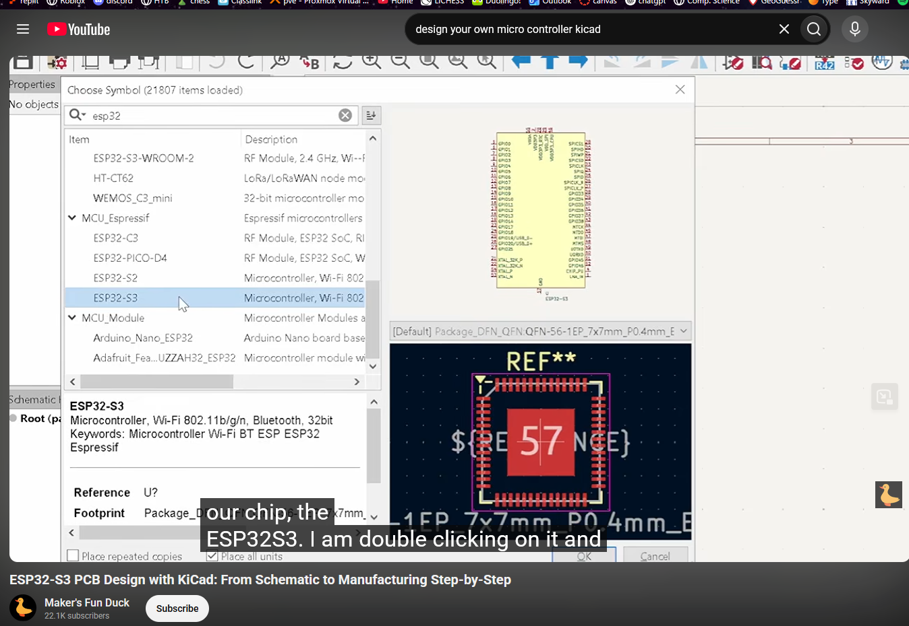
3d View of the board:
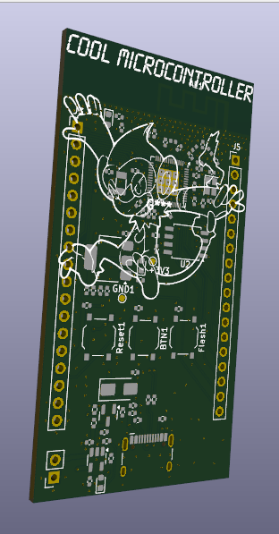
Overall, I know I'm really in tutorial hell but I'm kind of proud with how it came out as I placed,routed, and made the schematic it all by myself.
Now I'm ready to make the production files.
I did the production files, but for some reason the BOM.csv didnt transfer over the part number or the price which was weird, so I need to fix that.
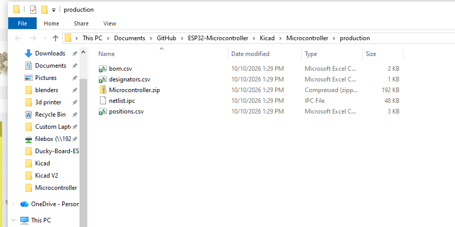
I'm also not sure if we are required to solder it ourselves or if we can get it with PCba. The rough cost of this pcb be will be ~$20
The parts itself will be $25.
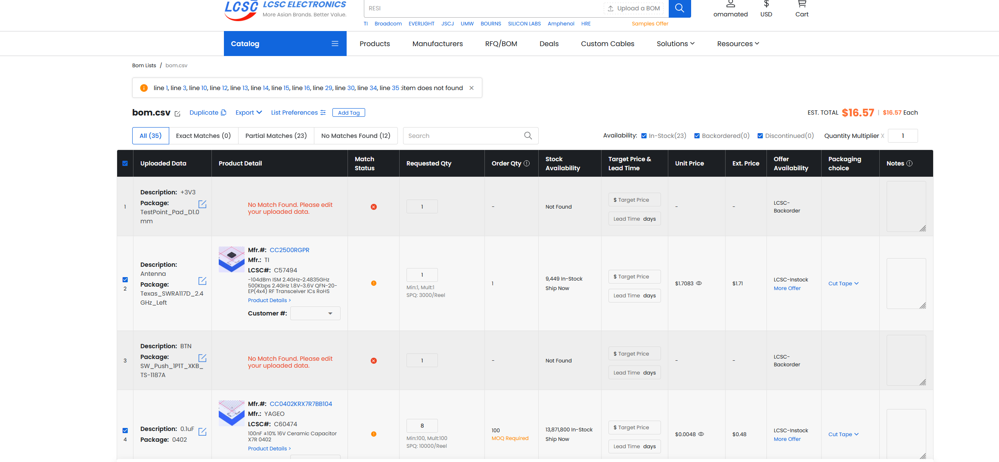
Overall, the microcontroller seems ready for me to ship so yeah!
